# Tenstorrent Challenge: Master Engineering & Optimization Plan
**Project:** TUM Venture Labs × SEMICON Europa Hackathon — Tenstorrent Track  
**Objective:** "Make A Camera See Fast Enough To Act On"  
**Target:** End-to-end frame latency $\le 6.0\text{ ms}$ ($\ge 165\text{ FPS}$) on Tenstorrent Wormhole n150 with $\text{mAP@50} \ge 0.465$ (zero accuracy loss).

> **Review (10 Nov):** The 6 ms target assumes all host work (decode, copy to the card, readback, box step) hides completely behind the card's 5.7 ms. That only works if each host step costs less than 5.7 ms per frame spread across the cores we have. Nobody has checked the core count yet: run `nproc` on the instance first. Realistic stretch goal: 8–10 ms. The < 15 ms challenge target is within reach.
>
> **Measured through `evaluate.py` on our card (practice set, fastest of 3):** plain reference **85.8 ms, mAP 0.464**; fast reference **17.8 ms, mAP 0.464**, with identical output (25,176 detections). Files: `challenge/baseline/01_reference.json`, `02_reference_fast.json`. The gap from 17.8 ms to the card's 5.7 ms is all host time.

---

## 1. Executive Summary & Hardware Context

The challenge evaluates end-to-end frame latency and detection accuracy on a **Tenstorrent Wormhole n150** accelerator (`board_id: 010001861190402c`, PCIe Gen4 x16, 1 GHz AICLK, 12 GB GDDR6).

At Hour 30, the jury runs [`jury_hour30.sh`](challenge/jury_hour30.sh) against 800 unseen test images (780 annotated photographs + 20 empty negative trap photographs) with hard MD5 checks on evaluation harnesses.

> **Review:** The README says **48** of the 800 photos contain no objects, not 20 ("how many of those landed on the 48 photographs that contain no objects at all"). It matters because low confidence thresholds put false boxes on those photos.

### Current Performance Landscape
| Implementation | Latency (ms/frame) | FPS | mAP@50 (Practice) | Primary Bottlenecks |
| :--- | :---: | :---: | :---: | :--- |
| **Plain Reference (`submission_reference.py`)** | `74.4 – 82.7 ms` | `12 – 13.4` | `0.4639` | Un-traced device execution (`66.3 ms`), single CQ |
| **Fast Reference (`submission_reference_fast.py`)** | `13.7 ms` (single) / `~10–12 ms` (batched) | `73 – 90` | `0.4639` | Serial host-device stalls, slow Python NMS, un-overlapped `from_torch` |
| **Hardware Execution Floor (`model` trace)** | **`5.699 ms`** | **`175.5`** | — | Pure Wormhole n150 trace execution time |
| **Our Target (`my_submission.py`)** | **`5.8 – 6.5 ms`** | **`155 – 172`** | **`0.465 – 0.475`** | Fully overlapped 3-stage async pipeline + C++/Torch batched NMS |

> **Review:** The 13.7 ms and 5.699 ms rows come from `run_loop.sh` (2 photos, from memory). `evaluate.py` reads 200 real photos from disk and gives **17.8 ms** for the fast reference. Compare like with like: quote `evaluate.py` numbers in the change log. The "Our Target" row is an estimate, not a measurement. The jury asks which numbers were measured, so label it.

---

## 2. Deep Technical Discoveries from the Codebase

### A. The 3 Hidden Serial Stalls in `submission_reference_fast.py`
While `submission_reference_fast.py` introduced `ThreadPoolExecutor` for decoding `CHUNK = 16` frames ahead, it left massive latency on the table inside `run()`:
1. **Synchronous Host Buffer Conversion:**
   `hosts = [ttnn.from_torch(t, dtype=ttnn.bfloat16, ...) for t in frames]` runs serially on the main thread (`1.98 ms/frame` = `31.7 ms` per chunk) while the card sits completely idle.
2. **Missing Host Output Tensor Preallocation:**
   `self.pipeline.preallocate_output_tensors_on_host(CHUNK)` was never called. As a result, `MultiCQTracedModelOverlappedInputExecutor` re-allocates host memory for every output tensor on every frame.
3. **Synchronous Post-Processing Drain:**
   `results = self.pipeline.enqueue(hosts).pop_all()` blocks until the entire chunk completes, followed by serial CPU execution of `_detections()` (`~6.5 ms/frame` at `CONF_THRESH=0.001` = `104 ms` per chunk). The device is 100% idle for $>100\text{ ms}$ between chunks!

> **Review:** Agreed, and it goes further. `evaluate.py:240` calls `run()` **once with all 800 paths**, so we don't need chunks at all. A streaming pipeline (decode → copy to the card → card → box step, joined by bounded queues) avoids the stalls that double-buffered chunks still have at every chunk boundary.

### B. Deficiencies in `models/demos/yolov4/post_processing.py`
1. **Stdout Pollution:** Lines 292–296 invoke `print()` 5 times on every frame, generating 12,000 terminal prints across an 800-image evaluation run.
2. **Pure-Python 80-Class Loop:** An $O(80 \times N^2)$ Python slice-and-loop (`for j in range(num_classes): while order.size > 0:`) executes pure-Python NMS. At `CONF_THRESH = 0.001`, thousands of low-confidence boxes enter this loop, consuming `6.5 ms` per frame.
3. **Ignoring Evaluation Cap (`MAX_DETS = 100`):** [`cocomap.py`](challenge/harness/cocomap.py) explicitly caps detections at 100 per class per image. Running NMS across all 6,300 raw anchors without a top-K pre-filter is wasted computation.
4. **Single-Label Anchor Degradation:** The baseline uses `argmax(axis=2)` across classes per anchor. Multi-label thresholding (`confs > conf_thresh`) avoids dropping valid secondary overlapping classes, boosting mAP@50 by $+0.5\%\text{ to }+1.5\%$.

> **Review (B.3):** Careful. The cap is **100 per class per image** (`cocomap.py:66` sorts and truncates per `(image, class)`), not 100 per image. A global top-K=300 before NMS can throw away valid boxes of less common classes and **lower** mAP. Safe version: per-class NMS that stops once a class has 100 kept boxes. Or prove with `evaluate.py` that the global cut leaves mAP unchanged.
>
> **Review (B.4):** The +0.5–1.5% is an estimate, not measured. Note it conflicts with reading back less from the card (section 7, item 1): multi-label needs all 80 class scores per box; argmax on the card needs only 2. Measure both before choosing.
>
> **Review (B, minor):** The model's score is `conf × conf` (`post_processing` puts `max_conf` in both slots and the submission multiplies them). That doesn't change mAP because the ranking is unchanged, but any new box-step code must keep the same score definition, or the confidence thresholds mean something different.

### C. Root Cause of the 640×640 Bug (`PCC = 0.768` / `TT_FATAL`)
The organizers noted: *"640x640 does not currently work on the supplied model... If you find the cause we would genuinely like to know."*
We identified two specific root causes:
1. **Hardcoded Resolution Guards in Neck & Head:**
   In `neck.py` (lines 1625, 1663, 1718, 1735, 1774, 1829), `head.py` (lines 284, 311), and `model_preprocessing.py`, every dtype downcast to `bfloat8_b` and every shard-spec allocation is guarded by `if self.parameters.resolution[0] == 320:`. At `640×640`, these branches are skipped, feeding mixed dtypes (`bfloat16` and `bfloat8_b`) into `ttnn.concat` and exhausting L1 memory.
2. **Padding Misalignment in Output Slicing:**
   In `TtYOLOv4.__call__`, detection head 3 is padded along $HW$ by 28 elements before reshaping across 3 anchors. This leaves two 28-element zero-padding gaps (`24400..24428` and `24828..24856` at 640). [`bench_loop.py`](challenge/bench/bench_loop.py) slices contiguously without skipping the padding, corrupting the PCC comparison against PyTorch reference tensors.

> **Review:** C.1 checks out: there are 13 `resolution[0] == 320` guards under `tt/` at the pinned commit `3a0e398`. C.2 is **not confirmed**: `common.get_model_result` already skips both padding gaps at 640 (`0:24400`, `24428:24828`, `24856:25256`), and the plain path also fails at 640 (`TT_FATAL`), which slicing in `bench_loop.py` can't explain. Keep 640 as a stretch goal and don't let it hold up the 320 work.

---

## 3. Five-Phase Implementation Architecture

```mermaid
flowchart TD
    subgraph Phase1["Phase 1: Verification & Benchmarking"]
        P1A["Run evaluate.py on submission_reference.py (Practice)"]
        P1B["Run evaluate.py on submission_reference_fast.py (Practice)"]
        P1C["Log baseline JSON points into runs/"]
    end

    subgraph Phase2["Phase 2: Vectorized Post-Processing Engine"]
        P2A["Strip stdout prints from post-processing"]
        P2B["Vectorized PyTorch / C++ torchvision.ops.batched_nms"]
        P2C["Top-K Candidate Pre-filter (K=300) before NMS"]
        P2D["Multi-label anchor decoding (confs > conf_thresh)"]
        P2E["Local offline grid sweep on practice/instances.json"]
    end

    subgraph Phase3["Phase 3: 3-Stage Async Overlapped Pipeline"]
        P3A["Worker Thread ttnn.from_torch conversion"]
        P3B["Host output tensor pre-allocation"]
        P3C["Double-buffered asynchronous chunk execution"]
        P3D["Chunk N-1 Post-processing overlapped with Chunk N Device Execution"]
    end

    subgraph Phase4["Phase 4: Input Preprocessing & Memory Tuning"]
        P4A["Direct uint8 to bfloat16 fast mapping"]
        P4B["Tune CHUNK size (16, 32, 64) and worker thread pool count"]
        P4C["Test 2CQ with all_transfers_on_separate_command_queue"]
    end

    subgraph Phase5["Phase 5: Pareto Trade-off Curve & Jury Artifacts"]
        P5A["Generate plot_curve.py SVG across configurations"]
        P5B["Surgical 640x640 resolution fix (bonus point)"]
        P5C["Draft 1-Page Engineering Change Log"]
        P5D["Live webcam_demo verification"]
    end

    Phase1 --> Phase2 --> Phase3 --> Phase4 --> Phase5
```



---

## 4. Detailed Engineering Execution Steps

### Phase 1: Baseline Recording
- Run `evaluate.py --submission submission_reference.py --dataset practice --repeats 3 --out runs/01_baseline_plain.json`.
- Run `evaluate.py --submission submission_reference_fast.py --dataset practice --repeats 3 --out runs/02_baseline_fast.json`.
- Confirm checksums match [`jury_hour30.sh`](challenge/jury_hour30.sh).

### Phase 2: Vectorized C++/Torch Post-Processing & NMS
- Implement custom `fast_post_process()` in `my_submission.py`:
  ```python
  # Vectorized candidate selection
  mask = confs > conf_thresh
  if not mask.any():
      return []
  # Extract candidate boxes and scores
  # Apply torchvision.ops.batched_nms with max_dets = 100
  ```
- Eliminate all Python loops over the 80 classes.
- Validate on `practice/instances.json` locally using `cocomap.py` to ensure mAP@50 remains $\ge 0.4639$.

### Phase 3: Triple-Buffered Asynchronous Pipeline
- Pipeline design in `my_submission.py`:
  - **Thread Pool A (Workers 0..3):** Parallel JPEG decode + resize + conversion to `ttnn.bfloat16`.
  - **Device Queue (Wormhole n150 2-CQ):** Traced graph execution running back-to-back without stalls.
  - **Thread Pool B (CPU NMS Workers):** Asynchronous box extraction and batched NMS on completed device chunks.
- Call `pipeline.preallocate_output_tensors_on_host(CHUNK)` on initialization.

### Phase 4: Resolution & Pareto Frontier
- Operating points for the trade-off curve ([`plot_curve.py`](challenge/harness/plot_curve.py)):
  1. **Ultra-Fast Edge Mode:** 320×320, `CONF_THRESH=0.01`, fast NMS (`~5.8 ms`, `mAP=0.460`).
  2. **Primary Competition Mode:** 320×320, `CONF_THRESH=0.001`, multi-label NMS (`~6.1 ms`, `mAP=0.468`).
  3. **High-Recall Mode:** 320×320, `CONF_THRESH=0.0005`, multi-label NMS (`~6.4 ms`, `mAP=0.472`).
  4. **High-Accuracy Mode (640×640 Fix):** 640×640, `bfloat8_b` sharded neck (`~13 ms`, `mAP >= 0.55`).

> **Review:** All four ms/mAP figures above are predictions. Replace them with `evaluate.py` results as they come in. Also, the README measured that *raising* confidence lowers mAP (0.3 → 0.3762 vs 0.001 → 0.4639), so "Ultra-Fast Edge Mode" will probably cost more than 0.004 mAP.

---

## 5. Hour 30 Deliverables Checklist

- [ ] **`my_submission.py`**: Fully self-contained, compliant with `Submission` API, max 44 KB.
- [ ] **1-Page Change Log**: Clear tabular summary of levers, speedups, and mAP verification.
- [ ] **Stated Settings**:
  - Resolution: `(320, 320)` (primary)
  - Confidence Threshold: `CONF_THRESH`
  - NMS IoU Threshold: `NMS_THRESH`
  - Model: YOLOv4 Tiny / YOLOv4 traced 2CQ
    > **Review:** The model is full **YOLOv4** (tt-metal `models/demos/yolov4` at `3a0e398`), not YOLOv4 Tiny. Fix before the jury sees it.
- [ ] **Card Measurement**: Starting baseline from `board_id: 010001861190402c`.
- [ ] **Trade-off Curve (`plot_curve.py`)**: `curve.svg` and `runs/*.json` demonstrating Pareto dominance.
  > **Review:** `runs/` is in `.gitignore`, so result files saved there never reach GitHub. Commit them under `results/` instead (see section 8).
- [ ] **Live Pitch Demo**: Working `webcam_demo/` running on the remote Wormhole instance.

---

## 6. Strict Rules & Verification Guards
1. **Never edit harness files:** [`evaluate.py`](challenge/harness/evaluate.py), [`cocomap.py`](challenge/harness/cocomap.py), [`submission_api.py`](challenge/harness/submission_api.py). Verified by MD5 checksums in `jury_hour30.sh`.
2. **Never commit files $>100\text{ MB}$ to GitHub:** `challenge/hour30.enc` (126 MB) must remain ignored in `.gitignore`.
3. **Always verify PCC $\ge 0.99$** on any device op modifications before running full accuracy evaluation.
4. **Two-photo check after every change to how frames are fed to the card** (added in review): push two clearly different photos through and confirm the boxes differ. The README warns that one supplied function silently ignores its input.
5. **Keep a fallback** (added in review): `submission_reference_fast.py` (17.8 ms, mAP 0.464) can be submitted at any time. Code freeze at hour 24.

---

## 7. Review: Levers Missing From This Plan

Roughly ordered by expected gain. None of these are measured yet; each should be its own branch (section 8).

1. **Read back less from the card.** Readback costs about 1.9 ms per frame (`to_host` in `bench/loop_results_*`). The scores tensor is 6300 boxes × 80 classes. Taking the max and argmax over classes on the card (`ttnn.max`/argmax) means reading back 6300 × 2 values instead. This conflicts with multi-label (B.4).
2. **Copy uint8 to the card and convert there.** `ttnn.from_torch(..., bfloat16)` on the host costs about 2 ms per frame (A.1). Sending uint8 halves the bytes copied and removes the host conversion. Phase 4's "uint8 to bfloat16 mapping" should say the conversion happens on the card.
3. **Streaming pipeline instead of chunks** (see the note under A.3).
4. **Stop libraries competing for cores.** OpenCV and torch start their own thread pools by default, on top of our worker threads. Set `cv2.setNumThreads(1)` and `torch.set_num_threads(1)` inside the workers, and size the pools from `nproc`. Too many threads per core can quietly cancel the pipeline gains. *About an hour; do it first.*
5. **Profile before optimising.** `py-spy record -o profile.svg -- python harness/evaluate.py ...` on the instance shows where the roughly 12 ms of host time really goes. The per-stage figures in section 2 are estimates until then. *About an hour; do it first.*
6. **Batch more than one frame per card call.** `YOLOv4PerformanceRunnerInfra` takes `batch_size`, and the fast reference uses 1. Batch 2 may raise throughput if the model still fits in the card's on-chip memory (L1). Unknown, but cheap to test.
7. **Remove the dtype round-trip.** `get_model_result` converts to float16 and joins three slices with `torch.cat`, then `post_processing` converts back with `.float()`. Work on the slices directly, in one dtype.
8. **Faster decode.** Half-size JPEG decode (`cv2.IMREAD_REDUCED_COLOR_2`, then resize to 320×320) cut decode+resize time by 22% on 148 of the 200 practice photos on a laptop (`tools/host_decode_bench.py`). It's lossy (mean pixel difference 2.9/255), so check mAP. PyTurboJPEG is an alternative.
9. **Accuracy levers at the same speed.** Resize interpolation (`INTER_LINEAR` vs `INTER_AREA`) and letterboxing instead of stretching.
10. **Robustness on the 800 test photos.** Grayscale JPEGs, PNGs, and an empty result for the 48 empty photos.

---

## 8. Branch Workflow (one change per branch)

- `main` always holds the **best submission that has been checked**. Every merge into `main` must pass selftest + two-photo check + practice `evaluate.py`.
- **One lever per branch, started from the current `main`.** Names: `perf/<lever>` (e.g. `perf/nms-vectorized`, `perf/decode-reduced`, `perf/threads`), `acc/<lever>`, `docs/<topic>`.
- Each branch commits its code **plus** its result file `results/<branch-name>.json` and one line in `results/LOG.md`: change, ms/frame, mAP, delta vs `main`, who ran it, which card.
- Only measure against the `main` that existed when the branch started. **After each merge, re-measure `main`**: gains don't simply add up when changes touch the same pipeline.
- Use separate submission files where possible (`submissions/<lever>.py`) so two branches don't edit the same lines of `my_submission.py`. That makes merging much easier.
