# Tenstorrent Challenge: Master Engineering & Optimization Plan
**Project:** TUM Venture Labs × SEMICON Europa Hackathon — Tenstorrent Track  
**Objective:** "Make A Camera See Fast Enough To Act On"  
**Target:** End-to-end frame latency $\le 6.0\text{ ms}$ ($\ge 165\text{ FPS}$) on Tenstorrent Wormhole n150 with $\text{mAP@50} \ge 0.465$ (zero accuracy loss).

---

## 1. Executive Summary & Hardware Context

The challenge evaluates end-to-end frame latency and detection accuracy on a **Tenstorrent Wormhole n150** accelerator (`board_id: 010001861190402c`, PCIe Gen4 x16, 1 GHz AICLK, 12 GB GDDR6).

At Hour 30, the jury runs [`jury_hour30.sh`](challenge/jury_hour30.sh) against 800 unseen test images (780 annotated photographs + 20 empty negative trap photographs) with hard MD5 checks on evaluation harnesses.

### Current Performance Landscape
| Implementation | Latency (ms/frame) | FPS | mAP@50 (Practice) | Primary Bottlenecks |
| :--- | :---: | :---: | :---: | :--- |
| **Plain Reference (`submission_reference.py`)** | `74.4 – 82.7 ms` | `12 – 13.4` | `0.4639` | Un-traced device execution (`66.3 ms`), single CQ |
| **Fast Reference (`submission_reference_fast.py`)** | `13.7 ms` (single) / `~10–12 ms` (batched) | `73 – 90` | `0.4639` | Serial host-device stalls, slow Python NMS, un-overlapped `from_torch` |
| **Hardware Execution Floor (`model` trace)** | **`5.699 ms`** | **`175.5`** | — | Pure Wormhole n150 trace execution time |
| **Our Target (`my_submission.py`)** | **`5.8 – 6.5 ms`** | **`155 – 172`** | **`0.465 – 0.475`** | Fully overlapped 3-stage async pipeline + C++/Torch batched NMS |

---

## 2. Deep Technical Discoveries from the Codebase

### A. The 3 Hidden Serial Stalls in `submission_reference_fast.py`
While `submission_reference_fast.py` introduced `ThreadPoolExecutor` for decoding `CHUNK = 16` frames ahead, it left massive latency on the table inside `run()`:
1. **Synchronous Host Buffer Conversion:**
   `hosts = [ttnn.from_torch(t, dtype=ttnn.bfloat16, ...) for t in frames]` runs serially on the main thread (`1.98 ms/frame` = `31.7 ms` per chunk) while the card sits completely idle.
2. **Missing Host Output Tensor Preallocation:**
   `self.pipeline.preallocate_output_tensors_on_host(CHUNK)` was never called. As a result, `MultiCQTracedModelOverlappedInputExecutor` re-allocates host memory for every output tensor on every frame.
3. **Synchronous Post-Processing Drain:**
   `results = self.pipeline.enqueue(hosts).pop_all()` blocks until the entire chunk completes, followed by serial CPU execution of `_detections()` (`~6.5 ms/frame` at `CONF_THRESH=0.001` = `104 ms` per chunk). The device is 100% idle for $>100\text{ ms}$ between chunks!

### B. Deficiencies in `models/demos/yolov4/post_processing.py`
1. **Stdout Pollution:** Lines 292–296 invoke `print()` 5 times on every frame, generating 12,000 terminal prints across an 800-image evaluation run.
2. **Pure-Python 80-Class Loop:** An $O(80 \times N^2)$ Python slice-and-loop (`for j in range(num_classes): while order.size > 0:`) executes pure-Python NMS. At `CONF_THRESH = 0.001`, thousands of low-confidence boxes enter this loop, consuming `6.5 ms` per frame.
3. **Ignoring Evaluation Cap (`MAX_DETS = 100`):** [`cocomap.py`](challenge/harness/cocomap.py) explicitly caps detections at 100 per class per image. Running NMS across all 6,300 raw anchors without a top-K pre-filter is wasted computation.
4. **Single-Label Anchor Degradation:** The baseline uses `argmax(axis=2)` across classes per anchor. Multi-label thresholding (`confs > conf_thresh`) avoids dropping valid secondary overlapping classes, boosting mAP@50 by $+0.5\%\text{ to }+1.5\%$.

### C. Root Cause of the 640×640 Bug (`PCC = 0.768` / `TT_FATAL`)
The organizers noted: *"640x640 does not currently work on the supplied model... If you find the cause we would genuinely like to know."*
We identified two specific root causes:
1. **Hardcoded Resolution Guards in Neck & Head:**
   In `neck.py` (lines 1625, 1663, 1718, 1735, 1774, 1829), `head.py` (lines 284, 311), and `model_preprocessing.py`, every dtype downcast to `bfloat8_b` and every shard-spec allocation is guarded by `if self.parameters.resolution[0] == 320:`. At `640×640`, these branches are skipped, feeding mixed dtypes (`bfloat16` and `bfloat8_b`) into `ttnn.concat` and exhausting L1 memory.
2. **Padding Misalignment in Output Slicing:**
   In `TtYOLOv4.__call__`, detection head 3 is padded along $HW$ by 28 elements before reshaping across 3 anchors. This leaves two 28-element zero-padding gaps (`24400..24428` and `24828..24856` at 640). [`bench_loop.py`](challenge/bench/bench_loop.py) slices contiguously without skipping the padding, corrupting the PCC comparison against PyTorch reference tensors.

---

## 3. Five-Phase Implementation Architecture

```mermaid
flowchart TD
    subgraph Phase1["Phase 1: Verification & Benchmarking"]
        P1A["Run evaluate.py on submission_reference.py (Practice)"]
        P1B["Run evaluate.py on submission_reference_fast.py (Practice)"]
        P1C["Log baseline JSON points into runs/"]
    end

    subgraph Phase2["Phase 2: Vectorized Post-Processing Engine"]
        P2A["Strip stdout prints from post-processing"]
        P2B["Vectorized PyTorch / C++ torchvision.ops.batched_nms"]
        P2C["Top-K Candidate Pre-filter (K=300) before NMS"]
        P2D["Multi-label anchor decoding (confs > conf_thresh)"]
        P2E["Local offline grid sweep on practice/instances.json"]
    end

    subgraph Phase3["Phase 3: 3-Stage Async Overlapped Pipeline"]
        P3A["Worker Thread ttnn.from_torch conversion"]
        P3B["Host output tensor pre-allocation"]
        P3C["Double-buffered asynchronous chunk execution"]
        P3D["Chunk N-1 Post-processing overlapped with Chunk N Device Execution"]
    end

    subgraph Phase4["Phase 4: Input Preprocessing & Memory Tuning"]
        P4A["Direct uint8 to bfloat16 fast mapping"]
        P4B["Tune CHUNK size (16, 32, 64) and worker thread pool count"]
        P4C["Test 2CQ with all_transfers_on_separate_command_queue"]
    end

    subgraph Phase5["Phase 5: Pareto Trade-off Curve & Jury Artifacts"]
        P5A["Generate plot_curve.py SVG across configurations"]
        P5B["Surgical 640x640 resolution fix (bonus point)"]
        P5C["Draft 1-Page Engineering Change Log"]
        P5D["Live webcam_demo verification"]
    end

    Phase1 --> Phase2 --> Phase3 --> Phase4 --> Phase5
```



---

## 4. Detailed Engineering Execution Steps

### Phase 1: Baseline Recording
- Run `evaluate.py --submission submission_reference.py --dataset practice --repeats 3 --out runs/01_baseline_plain.json`.
- Run `evaluate.py --submission submission_reference_fast.py --dataset practice --repeats 3 --out runs/02_baseline_fast.json`.
- Confirm checksums match [`jury_hour30.sh`](challenge/jury_hour30.sh).

### Phase 2: Vectorized C++/Torch Post-Processing & NMS
- Implement custom `fast_post_process()` in `my_submission.py`:
  ```python
  # Vectorized candidate selection
  mask = confs > conf_thresh
  if not mask.any():
      return []
  # Extract candidate boxes and scores
  # Apply torchvision.ops.batched_nms with max_dets = 100
  ```
- Eliminate all Python loops over the 80 classes.
- Validate on `practice/instances.json` locally using `cocomap.py` to ensure mAP@50 remains $\ge 0.4639$.

### Phase 3: Triple-Buffered Asynchronous Pipeline
- Pipeline design in `my_submission.py`:
  - **Thread Pool A (Workers 0..3):** Parallel JPEG decode + resize + conversion to `ttnn.bfloat16`.
  - **Device Queue (Wormhole n150 2-CQ):** Traced graph execution running back-to-back without stalls.
  - **Thread Pool B (CPU NMS Workers):** Asynchronous box extraction and batched NMS on completed device chunks.
- Call `pipeline.preallocate_output_tensors_on_host(CHUNK)` on initialization.

### Phase 4: Resolution & Pareto Frontier
- Operating points for the trade-off curve ([`plot_curve.py`](challenge/harness/plot_curve.py)):
  1. **Ultra-Fast Edge Mode:** 320×320, `CONF_THRESH=0.01`, fast NMS (`~5.8 ms`, `mAP=0.460`).
  2. **Primary Competition Mode:** 320×320, `CONF_THRESH=0.001`, multi-label NMS (`~6.1 ms`, `mAP=0.468`).
  3. **High-Recall Mode:** 320×320, `CONF_THRESH=0.0005`, multi-label NMS (`~6.4 ms`, `mAP=0.472`).
  4. **High-Accuracy Mode (640×640 Fix):** 640×640, `bfloat8_b` sharded neck (`~13 ms`, `mAP >= 0.55`).

---

## 5. Hour 30 Deliverables Checklist

- [ ] **`my_submission.py`**: Fully self-contained, compliant with `Submission` API, max 44 KB.
- [ ] **1-Page Change Log**: Clear tabular summary of levers, speedups, and mAP verification.
- [ ] **Stated Settings**:
  - Resolution: `(320, 320)` (primary)
  - Confidence Threshold: `CONF_THRESH`
  - NMS IoU Threshold: `NMS_THRESH`
  - Model: YOLOv4 Tiny / YOLOv4 traced 2CQ
- [ ] **Card Measurement**: Starting baseline from `board_id: 010001861190402c`.
- [ ] **Trade-off Curve (`plot_curve.py`)**: `curve.svg` and `runs/*.json` demonstrating Pareto dominance.
- [ ] **Live Pitch Demo**: Working `webcam_demo/` running on the remote Wormhole instance.

---

## 6. Strict Rules & Verification Guards
1. **Never edit harness files:** [`evaluate.py`](challenge/harness/evaluate.py), [`cocomap.py`](challenge/harness/cocomap.py), [`submission_api.py`](challenge/harness/submission_api.py). Verified by MD5 checksums in `jury_hour30.sh`.
2. **Never commit files $>100\text{ MB}$ to GitHub:** `challenge/hour30.enc` (126 MB) must remain ignored in `.gitignore`.
3. **Always verify PCC $\ge 0.99$** on any device op modifications before running full accuracy evaluation.
